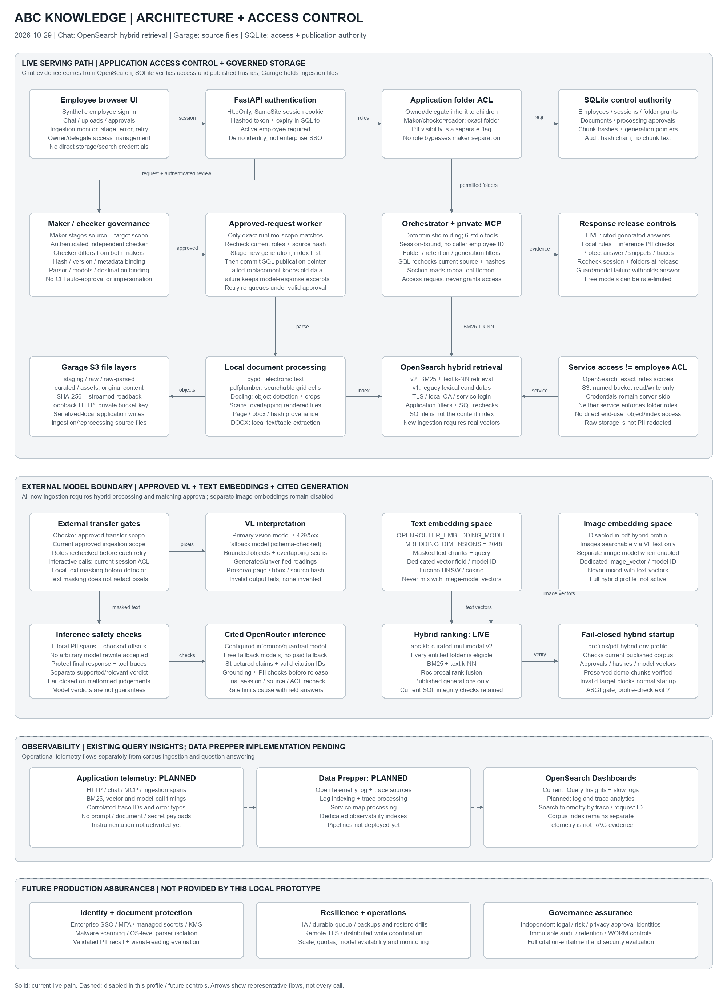

# Design and evaluation

> **Current design (2026-10-29):** Chat retrieves evidence from OpenSearch using BM25 + text-vector search and reciprocal rank fusion, then generates cited answers through OpenRouter. SQLite controls access and publication; Garage S3 holds source files and processing artifacts. New ingestion requires hybrid processing. Legacy lexical candidates remain readable. Data Prepper log/trace analytics is planned, not yet deployed. See the [current architecture](docs/architecture-and-access-control.md).

## Architecture and rationale

Editable source: [diagrams.net XML](docs/architecture-access-control/architecture.xml); generator: `scripts/render_architecture.py`. The diagram separates the **live hybrid path**, the **approved external-model boundary**, the **planned Data Prepper path**, and **future production assurances**. Previous root-level and `docs/architecture.*` copies are retained as historical assets.

The [architecture and access-control specification](docs/architecture-and-access-control.md) supplies the role matrix, inheritance rules, authentication flow, maker–checker scope binding, storage/service boundaries, retrieval/release checks and activation conditions. It is the text equivalent of the diagram, not performance data.

| Component | Role and reason |
|---|---|
| FastAPI + browser UI (`kb/app.py`) | Authenticated chat, onboarding, independent checker review and owner/delegate folder/grant management; session expiry and active-employee checks |
| SQLite controls (`kb/db.py`, `kb/security.py`) | Authoritative employees, grants, sessions, documents, processing requests/attestations, generation pointers and chunk integrity manifests; no document text in current OpenSearch-mode manifests. PostgreSQL remains optional. |
| Governance (`kb/governance.py`, `kb/processing_context.py`) | Bind approval to source hash/version/metadata and exact parser/model/destination/transfer scope; current maker/checker checks before ingestion/reindex transfer attempts and retries |
| ObjectStore (`kb/storage.py`) | Governed S3 staging/raw/raw-parsed/assets/curated layers with hashes and streamed verification; current Garage is loopback and application-serialized, not distributed/WORM storage |
| Parsers + pipeline (`kb/parsers.py`, `kb/pdf_hybrid.py`, `kb/pipeline.py`) | Local pypdf text, pdfplumber grids, Docling objects/scan regions; preserve page/object lineage. Index staged generations before SQL publication; failed replacement preserves the current generation. |
| Search (`kb/search.py`) | Live OpenSearch BM25/text-k-NN fusion; separate image-k-NN disabled, application ACL/retention/generation filtering and authoritative SQL candidate/section rechecks |
| Orchestrator (`kb/agent.py`) | Predictable manual intent routing and tool sequences, not autonomous LLM planning; final session/source/folder/PII-entitlement rechecks |
| MCP client / private server (`kb/mcp_server.py`) | Actual discovery/calls over stdio; identity bound to the authenticated session outside tool arguments |
| Model + guardrail gateways (`kb/providers.py`, `kb/guardrails.py`) | Active OpenRouter text embeddings/VL/generation; image embeddings disabled with distinct model spaces, local masking before external span detection, checked literal PII offsets and separate supported/relevant claim verdicts |
| Runtime gate (`kb/runtime.py`) | Validate storage, target mappings and current published manifests; target documents require approvals/vectors, while legacy documents retain lexical retrieval; configuration flags alone do not prove readiness |

### Access-control and ingestion choices

Owner/delegate privileges inherit through the folder hierarchy. Maker/checker/reader grants are exact-folder. Owners/delegates can stage and review, but a checker must differ from **both** source maker and requesting maker. PII visibility is a separate employee flag and never expands folder access or external-transfer rights. Only owners can delegate ownership; delegates manage ordinary grants. Chat access requests audit intent but do not grant access.

Maker uploads stage an S3 object and a pending `ProcessingRequest`. Authenticated checker approval binds source and target scope. External-domain review requires licence/legal/risk/data-protection evidence references; these are prototype checker attestations, not four independent approval organizations. CLI auto-approval/checker impersonation and maker compliance booleans are rejected.

Only a runtime-matching worker can claim approved work. New originals, raw-parsed JSON and curated JSON use request-specific generation paths; assets are content-addressed. Index writes finish before SQL manifests and the generation pointer are replaced. Expiry is enforced during retrieval, not just by housekeeping. Different-index cutovers require controlled maintenance and consistent backups; publication is not a seamless cross-index atomic switch. See [ingestion](docs/ingestion.md) and [parser limits](docs/parsers.md).

Employee ACLs are application controls, **not** OpenSearch DLS/FLS or S3 per-employee permissions. Backend credentials are server-side: OpenSearch has exact index scopes and verified local-CA HTTPS; Garage has a named-bucket read/write key over loopback HTTP. Direct credential holders bypass application folder checks. Original/raw/curated storage remains unmasked. Audit hash chaining is not immutable audit.

### Chunking and retrieval choices

Default maximum **1,800 characters** with **200-character overlap** uses parser section/heading blocks; it is not token-aware optimization. Default retrieval is **k=5**, API range 1–12. Current OpenSearch mode merges BM25 and text k-NN ranks; legacy-index documents remain lexical candidates until migrated. The earlier SQLite lexical fixture baseline is historical, not the current content index.

The active target uses 2048-dimensional text embeddings; the optional image-model embedding space is separate and disabled. Mappings use Lucene HNSW/cosine and recorded model IDs. Image retrieval embeds query text with the image model, not the text embedding model. Hybrid searches retrieve filtered candidates and fuse reciprocal ranks `1/(60 + rank)`. A one-shard/zero-replica development index is not HA. Hash embeddings are synthetic smoke vectors, not semantic evidence. There is no learned reranker or query-rewriting loop.

Current folder grants, retention and published generations filter retrieval. SQL document/chunk manifests authoritatively recheck source ownership, status, dates and text integrity. Section reads repeat authorization; release rechecks all cited evidence and current PII visibility. This guards stale/orphaned index entries, but does not make object URIs safe public links. Generation-ID term filters and SQLite coordination are prototype-scale choices.

### MCP transport, discovery and schemas

For each non-refused request, the orchestrator starts `python -m kb.mcp_server` as a private subprocess, supplies the server-bound session via `KB_MCP_SESSION`, initializes MCP, and discovers tools using `list_tools`. It invokes actual tools through `ClientSession.call_tool`. Tools authenticate the session and do not accept an employee ID for impersonation. Health performs discovery only. Traces show operational calls/results/timing, not hidden chain-of-thought.

| Tool | Principal inputs | Result / effect |
|---|---|---|
| `lookupemployeeaccesscontrol` | `{}` | Current employee, business unit, PII flag, folders and roles |
| `listbusinessfolders` | `{}` | Only entitled folder metadata |
| `searchdocuments` | `query: str`, `top_k: int = 5` | Entitled indexed evidence, masked according to caller |
| `getdocsection` | `chunk_id: str` | Section or null after fresh entitlement/status/integrity checks |
| `checkpiicompliance` | `text: str` | Masked/pass-through text and detector flag; not certification |
| `requestaccess` | `folder_id: str`, `reason: str` | Audit request, `pending_owner_review`, `access_changed: false`; unknown ID returns `not_found` |

### Agent workflows and safety

**Policy/access:** lookup access → list folders → retrieve evidence → resolve sections → cited generation or labelled extracts → PII/grounding gates as configured → release after session/entitlement/source recheck. “My permissions” uses access lookup/folder listing without policy search.

**Access request:** an explicit message starting `Request access to technology` records a pending-owner-review audit request. No grants change and no owner inbox is implied; owner/delegate grant management is separate.

Fixed injection patterns are refused before MCP startup. No accessible folders/evidence, tool/model failures and revoked access have escalation paths. This is not comprehensive prompt-injection protection or general ambiguity/topic detection. Top-k can retrieve irrelevant material; the earlier evaluation records that weakness rather than claiming universal refusal.

OpenRouter answers use structured cited claims, citation-ID checks and a separate model-based supported/relevant judgement. Inference masking validates literal spans/offsets rather than accepting rewritten text and protects final answers/snippets/traces. Invalid or unavailable checks fail closed. However, an external PII detector already receives a transfer; local rules/optional NER do not guarantee anonymity. Text masking cannot redact image pixels. Model judgements do not prove privacy or entailment. The original ten PDFs were enriched and hybrid-indexed; the full quality evaluation has not run.

## Evaluation assets and protocol

`evaluation/questions.json` contains **50 cases** with category, employee, question, expected keywords/tools, nullable escalation, gold answer and per-case rubric. Source policies and people are synthetic; retail Markdown and generated DOCX deliberately duplicate one source, while the supplemental escalation Markdown contains distinct evidence. Cross-format citation alone is not independent corroboration.

See [manual evaluation instructions](evaluation/README.md) for category counts, scoring, trace checks and full-evaluation protocol. No persistent automated test scripts were added. **The full 50-case human-quality evaluation remains unexecuted.** A separate [limited live-HTTP smoke artifact](evaluation/smoke-measurements.json) records the **historical SQLite/extractive baseline**, not the current OpenSearch/hybrid architecture: 16 selected synthetic cases, p50 **578.81 ms**, nearest-rank p95 **601.51 ms**, tool-coverage/citation-ID integrity passing 16/16 (including no-citation cases). These checks do not measure semantic groundedness or entailment. Q041 failed no-evidence handling: a DR street-address request returned related incident excerpts with null escalation instead of `insufficient_evidence`.

Four additional k=3/k=8 comparisons for Q021/Q025 supplement baseline k=5 observations. Q025 at k=3 lacked DOCX evidence, failing its cross-format requirement; k=5 and k=8 included DOCX and Markdown. Distinct supplement evidence was present in each comparison. This is limited retrieval-diversity evidence, not a full-suite ablation. See [verification](docs/verification.md) for broader smoke scope. Extractive and OpenRouter results must be recorded separately.

Recommended comparison: hold fixture versions/models/questions fixed; compare k=3 versus k=5. Record source coverage/extraneous citations; duplicate DOCX can crowd out distinct evidence. For performance, measure representative requests, separate cold starts from warm requests, and report sample count, failures and p50/p95 only after measurement. Historical SQLite timings must not be presented as OpenSearch or hybrid measurements.

Remaining evaluation gaps include general clarification, irrelevant top-k results, no calibrated semantic relevance threshold, masking altering required keywords, multi-document diversity and independently measured model-judge/PII/visual accuracy. A model-based grounding check now exists; its implementation is not a completed validation study.

## Deployment boundary

One local application runs UI/API, background worker and private MCP subprocesses; native Garage S3, SQLite controls and native OpenSearch serve the current deployment. PostgreSQL is optional. Normal hybrid serving requires the runtime readiness check; maintenance mode supports approvals while pausing chat and the embedded worker. No external deployment, full corpus load, HA, immutable audit, enterprise authentication or production privacy assurance is claimed. See [access-control specification](docs/architecture-and-access-control.md), [deployment status](deployed.md) and [remaining gaps](docs/current-gaps.md).
