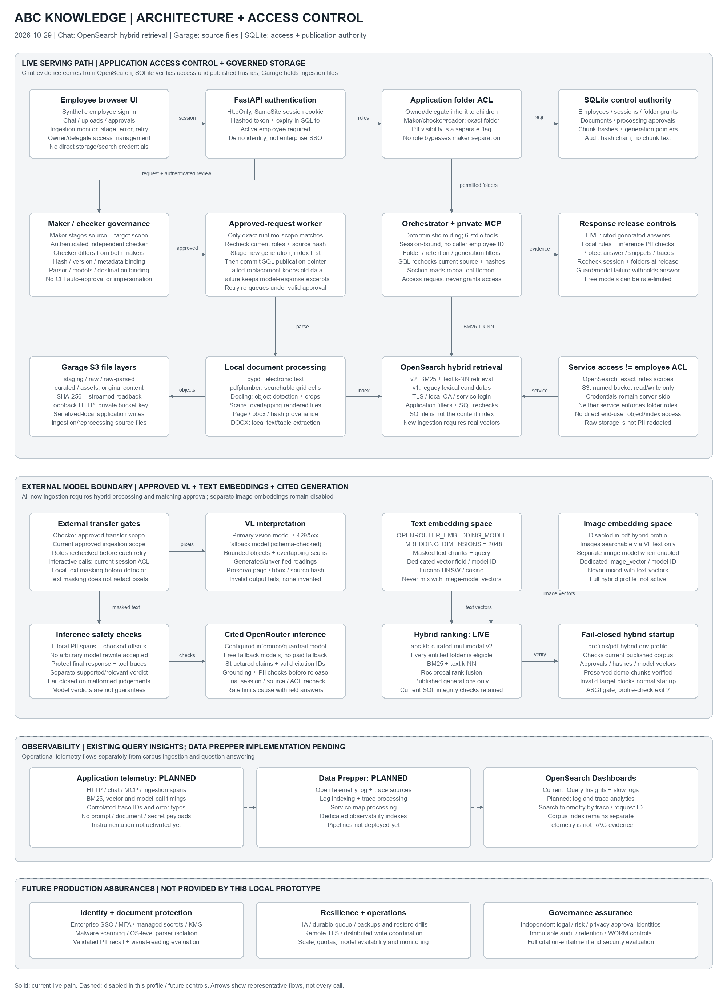

# Architecture and access control

Updated 2026-10-29. This describes the implemented prototype, not production assurance. Runtime status is the last verified rollout state (`pdf-hybrid` readiness passed with 273 verified chunks); generating this document does not inspect the corpus, run models or activate a profile.

- [Full-size PNG](architecture-access-control/architecture.png)
- [Editable diagrams.net XML](architecture-access-control/architecture.xml)
- Generator: `scripts/render_architecture.py` (Pillow; no application imports or document/model calls).
- Previous `docs/architecture.*` and root-level copies are retained as historical assets. The current diagram is in `docs/architecture-access-control/`; it does not overwrite those originals.

The monochrome diagram uses labels and solid/dashed lines rather than color to distinguish states. The tables and numbered flows below are its text equivalent. Arrows are representative dependencies, not a complete sequence/call graph.

## 1. Live versus pending

| Boundary | Current serving path (`pdf-hybrid`) | Not active |
|---|---|---|
| Durable configuration | `profiles/pdf-hybrid.env` (`KB_RUNTIME_PROFILE=pdf-hybrid`); `local` rejects new ingestion | Full `profiles/hybrid.env` (image embeddings) |
| Staff/access/structured records | SQLite | PostgreSQL optional |
| Files | Native Garage S3 on loopback | No SQL file-content migration required |
| Search | Chat searches BM25 + text k-NN in `abc-kb-curated-multimodal-v2`, with legacy lexical candidates from `abc-kb-curated-v1`; all entitled folders are eligible | Legacy-document vector migration remains separate; image vectors disabled |
| Response | OpenRouter cited generation with inference PII/grounding checks; failure withholds the answer | Paid/guaranteed-capacity models |
| Pilot corpus | 10 small PDFs indexed with VL-interpreted visuals; `profile-check` ready | Full-corpus enrichment |
| Ingestion visibility | UI Ingestion monitor with failure stage, model-response excerpts and Retry | Durable broker / DLQ |

Free OpenRouter models are rate-limited; the vision step has an approved fallback model for HTTP 429/502/503/504, and a malformed model result still fails closed. The `detector` field in a response reports the local PII rule layer (`rules-only-demo` without optional NER), separate from the inference PII check.

Checker review is **not** the same as permission to execute a real-document external transfer in this session. The local worker skips requests whose captured processing scope differs from its runtime. No diagram/document update enables external processing.

## 2. Identity and application permissions

The browser signs in through FastAPI using a synthetic employee ID and password. Passwords use salted scrypt hashes. A random session token goes into an HttpOnly, SameSite-strict cookie; SQLite stores its hash and expiry. Authenticated operations require an unexpired session and an active employee. Cookie `Secure` is configuration-controlled; local HTTP is not enterprise transport security.

The private MCP subprocess receives the authenticated session outside tool arguments. Its six tools do not accept a caller-selected employee identity. Access decisions come from current SQLite employees, folders and grants, not a user-supplied role, browser state or model response.

### Folder-role matrix

Employees may have multiple grants. An owner/delegate grant is inherited down the folder hierarchy; ordinary grants are **exact-folder only**, including a reader grant on a business root.

| Capability | Owner | Delegate | Maker | Checker | Reader |
|---|---|---|---|---|---|
| Read/search entitled, current documents | Yes | Yes | Yes | Yes | Yes |
| Create subfolders | Yes | Yes | No | No | No |
| Manage maker/checker/reader grants | Yes | Yes | No | No | No |
| Add/remove owner or delegate grants | Yes | No | No | No | No |
| Stage upload / request reprocessing | Yes | Yes | Yes | No | No |
| Approve/reject another maker's request | Yes* | Yes* | No | Yes* | No |
| Privileges inherited to descendant folders | Yes | Yes | No | No | No |
| Automatically obtain unmasked PII | No | No | No | No | No |

\* The checker must differ from **both** the original source maker and the requesting maker, even when they are an owner. Every participant must remain active and entitled. Root folders are operator-provisioned; the UI creates subfolders only. A folder must retain a direct owner.

`Employee.pii_unmasked` is a separate visibility entitlement. It does not grant another folder, skip source checks, permit unmasked external transfer or make raw storage safe for end-user access. Chat access requests only create audit requests; they never change grants.

Implementation: [security](../kb/security.py), [HTTP authentication and grant management](../kb/app.py), [MCP server](../kb/mcp_server.py).

## 3. Maker–checker processing boundary

1. An entitled maker stages one source in S3, or requests exact-ID reprocessing. SQLite records source SHA-256, version, folder, metadata, source maker and an idempotency key.
2. A `ProcessingRequest` binds those source properties and an exact public processing snapshot: parser limits, models/dimensions, destination index/bucket, image/scan transfer kinds and guardrail settings. Private credentials are not serialized into that scope.
3. A separately authenticated entitled checker reviews the captured request and echoes its ID/scope digest. Reviewing a target hybrid scope through the local UI is supported; executing it still requires an exact runtime match.
4. External-domain documents require a licence reference and checker evidence references for licence, legal, risk and data protection. These are checker attestations, **not** four independently authenticated approval organizations.
5. The worker claims only approved requests matching its runtime scope. It rechecks source integrity, scope and current participants' entitlements. Ingestion/reindex external requests repeat approval checks **before every HTTP attempt**, including retries.
6. Changed source/metadata/scope or revoked roles prevents processing. CLI-supplied checker IDs, auto-approval switches and maker-entered compliance booleans cannot authorize work. Interrupted jobs require fresh review, not approval resurrection.

### Ingestion monitor and retry

`GET /api/ingestion` lists each accessible document's latest request with its stage (awaiting checker, queued, processing, indexed, failed, rejected, cancelled). For a failure it returns the fixed error, pipeline stage and, to makers/checkers/owners only, PII-masked bounded excerpts of model responses (HTTP status, model ID, invalid output) captured during that run and stored in the `ingestion.failed` audit event. API keys are stripped.

`POST /api/processing-requests/{id}/retry` is available to makers, checkers and owners. If the failed request's checker approval still binds the unchanged source, metadata and scope and participant entitlements still hold, the **same request is re-queued** without new review and audited as `processing.retried_under_existing_approval`. Otherwise a fresh maker request is created and needs checker review. Re-queued requests still run only on a worker whose runtime scope matches.

Implementation: [governance](../kb/governance.py), [transfer context](../kb/processing_context.py), [reprocessing](../kb/reprocess.py), [pipeline](../kb/pipeline.py).

## 4. File, control and search persistence

| Store | Authoritative content | Access boundary / limitation |
|---|---|---|
| SQLite | Employees, active status, sessions, folder hierarchy/grants, document versions/status, processing requests/attestations, current chunk integrity manifests/generation pointers and audit chain | Application/worker controls; current OpenSearch-mode manifests do not store document text. Audit hash chaining is not immutable audit storage. |
| Garage S3 | `staging`, `raw`, `raw-parsed`, `curated`, `assets` | Private server-side key with read/write only on the named bucket; no bucket-owner permission. Original/parsed content is not PII-redacted. |
| OpenSearch | Searchable document/chunk text, provenance and optional vector fields | Verified local-CA HTTPS and exact index-scoped service role. Folder/retention/generation restrictions are application filters, followed by authoritative SQL checks. |

### Service credentials are not employee ACLs

- Employees authenticate to the application, **not** directly to S3/OpenSearch. Object URIs and content-addressed asset names are references, not authorization tokens or public download links.
- The OpenSearch service role restricts allowed indexes; it does not implement employee-specific document/field-level security. A direct service-credential holder bypasses application folder filtering.
- The S3 runtime key is bucket-scoped, not per-employee/per-folder. A credential holder can access unmasked stored content. Protect host files, credentials and operational/admin access separately.
- Garage uses approved loopback HTTP. An application-wide `serialized-local` file lock coordinates create-only writes because this Garage deployment did not enforce conditional PUTs. It is not server-atomic/distributed immutability and does not constrain other clients that bypass the lock.
- SHA-256 metadata, streamed write readback and expected source hashes provide integrity checks; ETags are not treated as content hashes.

New generation keys include the processing request ID. Assets remain content-addressed. The worker finishes new index writes before atomically replacing SQLite chunk manifests and the current-generation pointer. Failed replacement leaves the published generation intact. Cross-index publication is **not** a seamless atomic alias switch: use a controlled maintenance window and consistent backups before target processing/cutover.

Implementation: [database](../kb/db.py), [object storage](../kb/storage.py), [search](../kb/search.py), [storage deployment limits](object-storage.md).

## 5. Retrieval and response-release checks

1. Validate the current session/active employee; resolve current entitled folder IDs from SQLite.
2. Query OpenSearch using folder, seven-year retention and published-generation filters. BM25 covers the current target plus the legacy fallback index; query embeddings search the target vector field, and reciprocal rank fusion merges candidates. This is not restricted to `pdf-pilot`; staged/obsolete generations must not enter hybrid fusion.
3. Recheck candidates against SQL document/chunk ownership, status, dates, current grants, published manifests and text hashes. Missing/inconsistent content is withheld.
4. MCP section reads repeat entitlement/status/integrity checks. Only entitled evidence can enter response construction.
5. With `LLM_PROVIDER=openrouter` (current), the model returns structured claims; the application checks citation IDs, obtains a separate supported/relevant grounding verdict, and applies inference-assisted PII protection to the answer, snippets and traces. (`local` mode returns labelled cited excerpts instead.)
6. Immediately before release, recheck session, current PII entitlement, source sections and folder access. Model or tool output cannot grant access. Guard failures withhold the response rather than silently bypassing checks.

Local rules and optional NER run before external text PII inference. The external detector's input is itself a transfer, not proven anonymous data. Text masking does **not** redact document pixels. Model judgements can miss PII or approve unsupported claims; citation-ID validation alone does not prove entailment.

Implementation: [retrieval](../kb/search.py), [orchestration/release](../kb/agent.py), [guardrails](../kb/guardrails.py), [providers](../kb/providers.py).

## 6. Mandatory hybrid ingestion and multimodal processing

All UI uploads, ingestion requests, retries and index writes require hybrid settings and real embeddings. PDF processing additionally requires approved VL image transfer. Legacy documents can still contribute lexical candidates until their separately approved hybrid reprocessing completes. `OPENSEARCH_HYBRID_FOLDERS` remains historical approval-scope metadata, not a folder restriction.

Local PDF extraction uses **pypdf electronic text**, **pdfplumber searchable ruled-grid cells** and **Docling layout/object crops**. Sparse or raster-dominant scan pages render into overlapping bounded tiles. VL-disabled scans fail rather than publishing unreadable placeholders. The tiles may collectively cover an entire page, so checker scope and direct image-transfer permission must cover that exposure.

| Model task | Configuration / identity | Search or safety role |
|---|---|---|
| Text embeddings | `OPENROUTER_EMBEDDING_MODEL`, `EMBEDDING_DIMENSIONS=2048` | Text chunks and text-query vectors in `vector` |
| Image embeddings | `OPENROUTER_IMAGE_EMBEDDING_MODEL`, `IMAGE_EMBEDDING_DIMENSIONS=2048` | Crop pixels and text queries in the image model's own `image_vector` space |
| VL interpretation | `OPENROUTER_VISION_MODEL` | Generated/unverified object/scan readings; retain model, page, bbox and source hash |
| Answer generation | `OPENROUTER_MODEL` | Claims over currently entitled cited evidence |
| PII / grounding judge | `OPENROUTER_GUARDRAIL_MODEL`, or configured inference model | Checked literal PII spans plus separate supported/relevant verdicts; no privacy/factual guarantee |

Text and image vectors are **not interchangeable**, even with equal dimensions. Target mappings record model identities and use Lucene HNSW/cosine in separate fields. Hybrid retrieval fuses BM25, text k-NN and image-model k-NN ranks using `1/(60 + rank)`.

The hybrid startup gate verifies S3 and target mappings, then checks each current non-expired document in its published index. Target-index documents require current approvals and finite nonzero model-compatible vectors; legacy-index documents require intact manifests and hashes but may remain lexical-only. Image vectors are required only when image embeddings are enabled. An empty target cannot start normal hybrid serving. This is enforced in ASGI startup as well as the read-only `profile-check` CLI (exit 2 when unready).

Current state: the `pdf-hybrid` profile passed readiness for the ten pilot PDFs with separate image embeddings disabled (images contribute through VL-generated text). Remaining work for the full profile: image embeddings, approved vectors for the remaining corpus, and a controlled cutover. See [governed rollout](governance-and-activation.md). No model call was made by generating these assets.

## 7. Where chat obtains information

Chat follows **browser → FastAPI → private MCP → OpenSearch → verified evidence → OpenRouter generation → release checks → browser**. The question gets a text embedding for k-NN retrieval alongside its BM25 query. OpenSearch returns chunk text and provenance; SQLite validates folder access, document state, current generation and chunk hashes. Section retrieval also uses the published document's OpenSearch index.

Garage stores the source files and ingestion artifacts. The worker fetches originals from Garage for parsing/reprocessing, enriches PDF image regions through approved VL calls, chunks and embeds the content, indexes it in OpenSearch, then publishes SQL manifests. Chat does not fetch originals from Garage for each question. SQLite is the control authority, not the live content search engine.

## 8. Log and trace analytics boundary

Current observability consists of the ingestion monitor, SQL audit events, OpenSearch Query Insights and search slow logs. The browser's tool trace is an application response field, not an OpenTelemetry distributed trace. Existing slow logs can contain raw question text; see [observability operating notes](opensearch-observability.md).

The requested Data Prepper architecture is **application OpenTelemetry logs/spans → Data Prepper → separate OpenSearch observability indexes → Dashboards log/trace analytics**. Planned spans cover HTTP/chat, private MCP retrieval, BM25/vector operations, model calls and ingestion. Trace IDs correlate timing and errors; prompts, source text, model responses and credentials should not be exported. Corpus indexes remain the only retrieval evidence source.

**Implementation status:** SDK dependencies were installed during investigation, but application instrumentation, Data Prepper pipelines and end-to-end export have not yet been implemented or verified. Dashed arrows in the diagram show this planned path; they do not claim a running service.

## 9. Production boundaries

Demo sign-in is not SSO/MFA. Parser libraries are not an OS sandbox. The prototype does not provide malware scanning, independently authenticated legal/risk/privacy organizations, immutable/WORM audit, managed KMS/secrets, remote Garage TLS/HA, distributed write locks, tested disaster recovery, terabyte-scale access filtering, or a completed privacy/visual/grounding quality evaluation. Generation-ID term filters and SQLite coordination are prototype-scale choices.

No new permission grants, model calls, service restarts, corpus reads or activation are part of generating these architecture assets.
